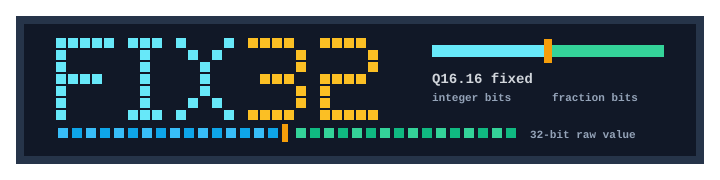
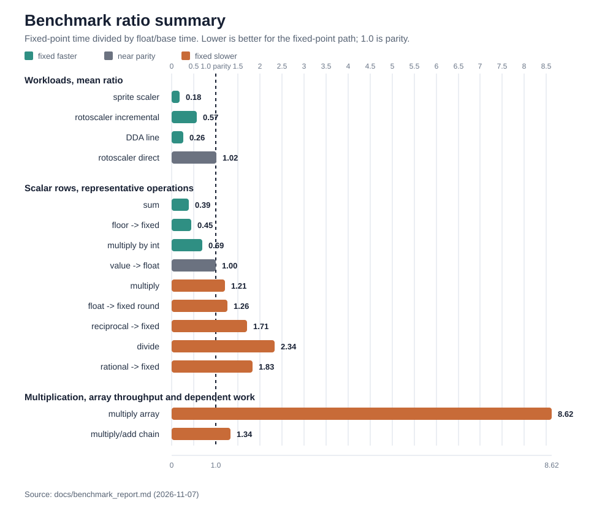

<p align="center">
  
</p>

# Introduction

`fix32` is a small C99 [single header only](https://en.wikipedia.org/wiki/Header-only) [fixed-point](https://en.wikipedia.org/wiki/Fixed-point_arithmetic) math library.

I started to write this library to support fixed-point math in my [game engine](https://tofuengine.org/). Other fixed-point libraries exist, and some of them are quite good, but... well, we all have our own preferences and priorities when it comes to design and implementation, and I wanted to write my own library that fits my specific needs and style.

That said, I didn't want to make it a one-off for my game engine, but generally useful and reusable.

Internally, it uses a signed 32-bit `fix32_t` representation which is a good balance between range and precision in most scenarios. It includes conversion helpers for integers, floating-point values, and integer ratios, basic arithmetic, interpolation, plus a number of configuration options to allow users to customize the behavior and performance characteristics of the library to suit their specific needs.

By no means a comprehensive fixed-point library (see [libfixmath](https://code.google.com/archive/p/libfixmath/) for that purpose), `fix32` provides a basic set of operations and helpers that are commonly needed in game development and other performance-sensitive applications.

It's designed to be portable and configurable, with a focus on performance and ease of use.

## Usage

To use the library, drop the header in your project and include it from the C files that use fixed-point math:

```c
#include "fix32.h"

// Your code here...
```

In exactly one translation unit, define `FIX32_IMPLEMENTATION` before including the header so the function bodies are emitted:

```c
#define FIX32_IMPLEMENTATION
#include "fix32.h"
```

> If you want the previous fully inline behavior for hot code, define `FIX32_STATIC_INLINE` before including `fix32.h`. That emits `static inline` definitions in the current translation unit. `FIX32_INLINE` can also be defined first if a compiler-specific inline spelling is needed.

As simple as that! The library is designed to be easy to integrate into existing projects without additional setup.

A number of configuration macros are available to customize the behavior and performance characteristics of the library. These can be defined at compile time to enable or disable specific features or optimizations:

- `FIX32_IMPLEMENTATION`: emits the external function definitions from one
  translation unit
- `FIX32_STATIC_INLINE`: emits `static inline` definitions in the including
  translation unit instead of using external definitions
- `FIX32_INLINE`: overrides the inline spelling used by `FIX32_STATIC_INLINE`,
  default `static inline`
- `FIX32_FRACTIONAL_BITS`: fractional precision, default `16`
- `FIX32_USE_ARITHMETIC_SHIFT_FLOOR`: selects the fast floor/ceil path, default
  `1`
- `FIX32_USE_SIGNED_SHIFT_MUL`: enables signed-shift scaling for `fix32_mul()`,
  default `0`
- `FIX32_USE_SIGNED_SHIFT_DIV`: enables signed left-shift scaling for
  `fix32_div()`, default `0`; numerators must be nonnegative
- `FIX32_USE_64_BIT`: selects wider intermediates for selected operations,
  default `1`
- `FIX32_INTEGER_BITS`: optional operand-range hint used to auto-select
  `FIX32_USE_64_BIT`; it is not enforced at runtime
- `FIX32_NO_ROUNDING`: switches the `FIX32_FROM_FLOAT`, `FIX32_FROM_DOUBLE`,
  and `FIX32_TO_INT` helper macros to truncating variants

`FIX32_FRACTIONAL_BITS` changes the scale, but it does not by itself create a
checked Q-format. For example, 8 fractional bits are useful for a Q16.8-style
value range, but full-range Q16.8 multiplication still needs a wide
intermediate. When `FIX32_USE_64_BIT=0`, the active helper definitions avoid `int64_t`.
That narrow profile is only appropriate when the caller also keeps the actual
operand range small enough for the documented intermediate contract.

Typical overrides look like this:

```sh
make CFLAGS="-O2 -DFIX32_NO_ROUNDING"
make benchmark BENCH_CPPFLAGS="-DFIX32_STATIC_INLINE"
make benchmark BENCH_CFLAGS="-O3 -DFIX32_USE_SIGNED_SHIFT_MUL=1"
```

## Build

```sh
make
```

This builds the default test and benchmark executables under `build/`.
Changes to compiler, preprocessor, optimization, or linker flags automatically
rebuild the executables. Use `BUILD_DIR` to keep separate configurations.

## Test

The test suite is included under `src/test/`. It covers arithmetic and conversion
policies, floating-point rounding boundaries, and integer limits inside the
library's unchecked input contract.

To run the tests, simply execute:

```sh
make test
```

The test target exercises external and static inline usage, portable floor/ceil,
no-rounding mode, narrow arithmetic, and signed-shift multiplication/division. Boundary
tests run at every fractional-bit count from 1 through 30 in both wide and narrow
profiles. A benchmark data test checks coverage of both signs and every divisor
in the documented integer ranges.

Integer rounding uses unsigned 32-bit intermediates and handles every raw value,
including `INT32_MIN`, in both profiles. Division scales by multiplication by
default. `FIX32_USE_SIGNED_SHIFT_DIV=1` selects signed left-shift scaling for
nonnegative numerators; the scaled numerator must fit the selected arithmetic
path. The test suite exercises this option with both wide and narrow intermediates.

## Benchmark

```sh
make benchmark
./build/benchmark 8192 100
make run-benchmark BENCH_ARGS="8192 100"
make run-benchmark-32-bit BENCH_ARGS="8192 100"
```

The benchmark compares fixed-point and floating-point work for scalar math, line stepping, sprite scaling, and sprite roto-scaling. The reason for this kind of benchmark is to provide a realistic performance comparison between fixed-point and floating-point math in the context of game development, where these operations are commonly used (or, at least, they are in the context of my game engine :D).

The `run-benchmark` target captures the benchmark output under `build/` and regenerates the summary graph used below.

Timings report the median of five trials after a warm-up, with alternating
fixed/float execution order and the trial range printed beneath each row. The
multiplication section separates ordinary array throughput from a dependent
multiply/add chain. Build the external-function configuration, optionally with
LTO, to compare it with the default inline benchmark:

```sh
make benchmark BUILD_DIR=build/external BENCH_CPPFLAGS=
make benchmark BUILD_DIR=build/lto BENCH_CPPFLAGS= BENCH_CFLAGS="-O3 -flto"
```

The `run-benchmark-32-bit` target builds a restricted-range profile with `FIX32_USE_64_BIT=0` and 8 fractional bits. It is intended for checking whether the narrow arithmetic path is worth profiling on a constrained target; it is not the canonical benchmark report.

The November 7, 2026 report below uses the current implementation and benchmark
method. The graph shows fixed-point time divided by float or base time; lower
ratios favor fixed point, and `1.0` is parity. Workload bars are unweighted means
of the case ratios. Scalar and multiplication bars show individual rows. See
the report for build details, trial ranges, release validation, and the separate
configuration comparisons.



See [docs/benchmark_report.md](docs/benchmark_report.md) for the complete measurements and [docs/benchmark_details.md](docs/benchmark_details.md) for methodology.

## Notes

- Design: [docs/design.md](docs/design.md)
- Benchmark details: [docs/benchmark_details.md](docs/benchmark_details.md)
- Benchmark report: [docs/benchmark_report.md](docs/benchmark_report.md)
